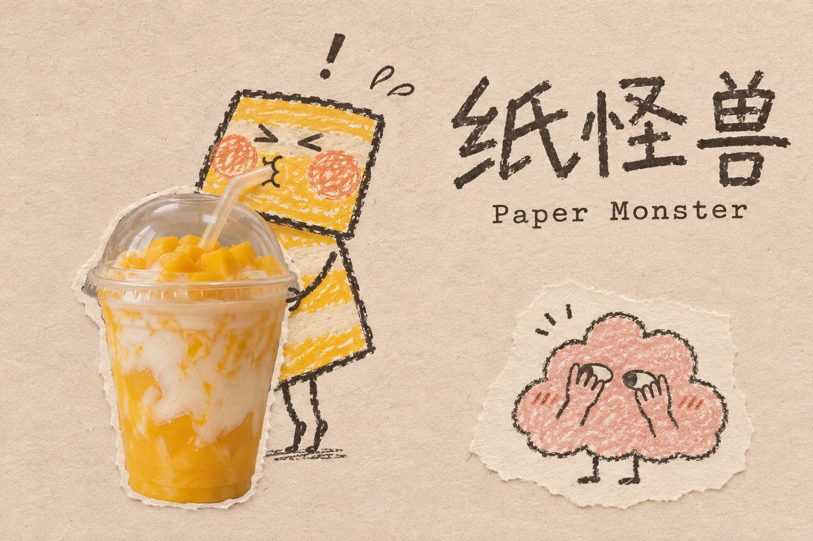
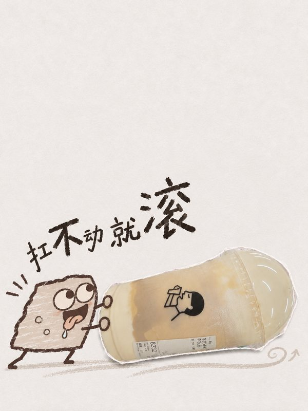
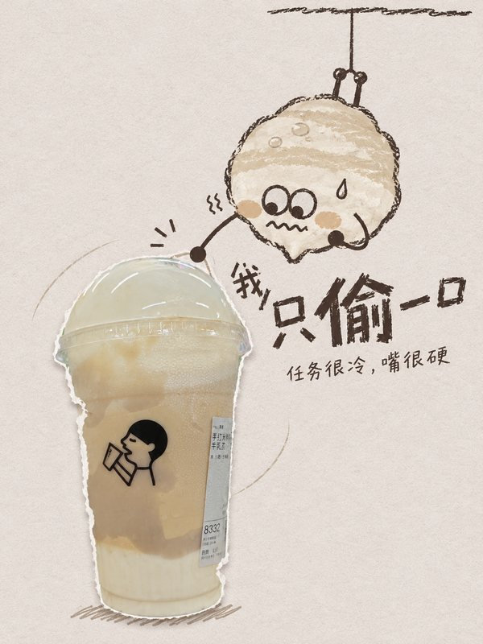
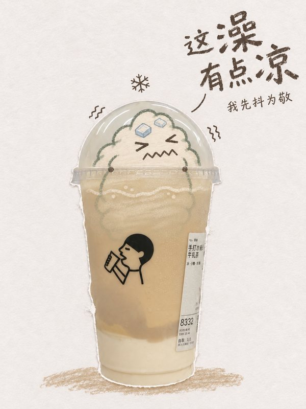
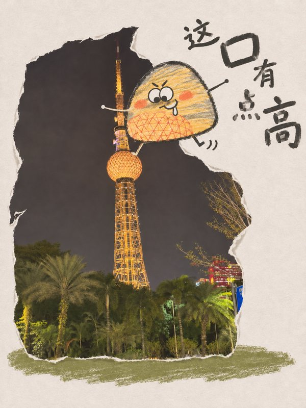
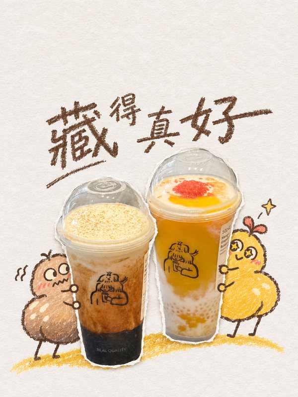
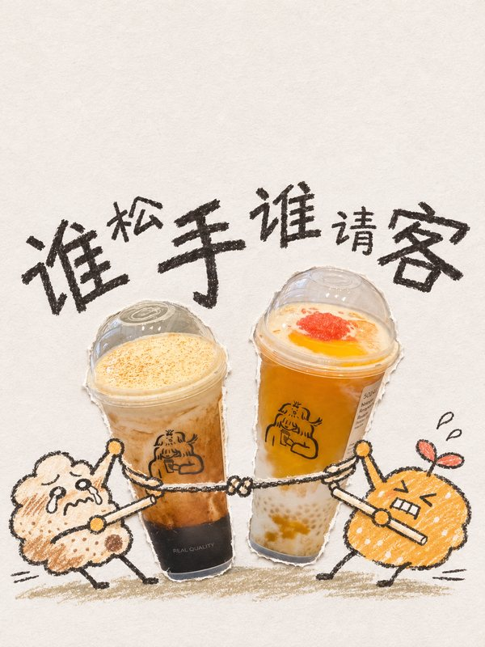
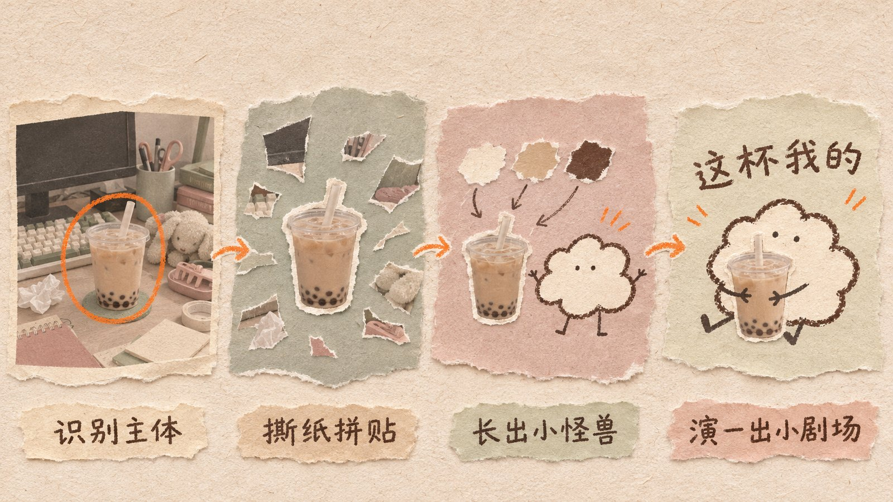

<div align="center">



# 纸怪兽 · Paper Monster

**一张随手拍，撕成纸片，养出一只小怪兽，演一格小剧场。**

一个图像生成 Agent Skill：把照片里的主角撕下来贴在安静的纸面上，再从照片的颜色和材料里养出一只蜡笔小怪兽，让它和主角演一出夸张的戏，配一句好笑的心里话。

[效果](#效果) · [工作方式](#工作方式) · [安装](#安装) · [使用](#使用) · [剧本库](#剧本库)

</div>

---

## 效果

以下海报均由本 skill 生成，原图是三张随手拍：一杯奶茶、一座夜景电视塔、桌上的两杯饮品。

| | | |
|:---:|:---:|:---:|
| <br>大力士 ·「扛不动就滚」 | <br>特工倒吊 ·「我只偷一口」 | <br>杯里泡澡 ·「这澡有点凉」 |
| <br>场景 · 爬塔偷灯 ·「这口有点高」 | <br>群戏 · 捉迷藏 ·「藏得真好」 | <br>群戏 · 拔河 ·「谁松手谁请客」 |

## 工作方式



每张海报由四层纸叠成，每层只做一件事：

| 层 | 是什么 | 任务 |
|---|---|---|
| ① 底纸 | 低饱和的哑光纸面 | 安静、留白 |
| ② 照片纸片 | 从原图撕下来的真实部分 | 证明“这是我拍的” |
| ③ 蜡笔层 | 小怪兽和少量手绘 | 制造笑点 |
| ④ 字 | 一句心里话 | 把笑点说破 |

制作分七步：

1. **看**：先判断照片拍的是物件、场景还是一组东西。
2. **撕**：物件只留东西本身（手和背景都去掉），场景整张撕成纸片，一组东西就每件各撕一张。
3. **铺**：选一种纸色，再从照片里挑一个颜色灰化后当强调色。
4. **养**：照着主体的外形捏出一只矮胖的小怪兽（圆顶杯盖变软圆团、芒果粒变软糖方块），再填配方卡：颜色、记号、表情、剧情和镜头。可爱永远排第一，搞怪靠表情和动作。
5. **写**：一句不超过 8 个字的心里话。调皮的用歪扭儿童字，安静的用宋体。
6. **画**：按四层纸的顺序组装提示词，交给生图工具。
7. **验**：检查归类、毛边、怪兽和字，哪项有问题只修哪项。

## 安装

本 skill 需要宿主 Agent 能生成图像，推荐在 **Codex（ChatGPT）** 里用：

```bash
git clone https://github.com/aloneusername/paper-monster.git ~/.codex/skills/paper-monster
```

装好后如果没出现，重启 Codex。其他支持 Agent Skills 并带生图工具的 Agent 也可以用。

## 使用

附上一张照片：

```text
用 $paper-monster 把这张照片做成海报
```

也可以只指定一部分，其余随机：

```text
用 $paper-monster 做海报，剧情用「骑着飞」
用 $paper-monster 做海报，小怪兽要 Q 版大头，表情泪汪汪
用 $paper-monster 做海报，文字写「周一续命」，用宋体
用 $paper-monster 做一张不带字的
用 $paper-monster 做海报，不要小怪兽
```

## 剧本库

完整内容见 [`references/plots.md`](references/plots.md)。

| 类 | 举例 |
|---|---|
| 大力士 | 背不动、小菜一碟、举过头顶、拖走、扛着冲刺 |
| 坐骑 | 骑着飞、杯盖热气球、吸管划船、吸管滑梯 |
| 抢 | 一口吞、护食、偷吸、藏不住、贴便签宣示主权 |
| 讨好 | 求一口、假装晕倒、捶背扇风、含泪递给你 |
| 安家 | 杯盖开门、靠杯露营、杯里泡澡、吸管攀岩 |
| 状态 | 冻成冰棍、喝撑打嗝、插吸管续命、惊掉下巴 |
| 魔法 | 漂浮咒、骑扫帚、熬魔药、变身失败、隐身斗篷 |
| 大片 | 倒吊潜入、巨石狂奔、子弹时间、英雄落地、船头张臂（只借动作，不用任何电影角色和标志） |
| 群戏 | 拔河、叠罗汉、劫案小队、西部决斗、排队、捉迷藏 |

场景图另有一套：扒着撕口往里看、想吞掉月亮、骑一片云飞过天空……

## 致谢

创作时受到 [Zeejay0 / gathered-scenes-zine-skill](https://github.com/Zeejay0/gathered-scenes-zine-skill) 的实景拼贴，以及 [Hchen1218 / heytea-style](https://github.com/Hchen1218/heytea-style) 的风味小怪兽的启发，在此致谢。本 skill 是独立重写的作品，不包含上述项目的文本、图片或脚本。

示例中出现的饮品包装和标识归各自权利人所有。本项目与任何品牌无关。

## 许可

[MIT](LICENSE)
